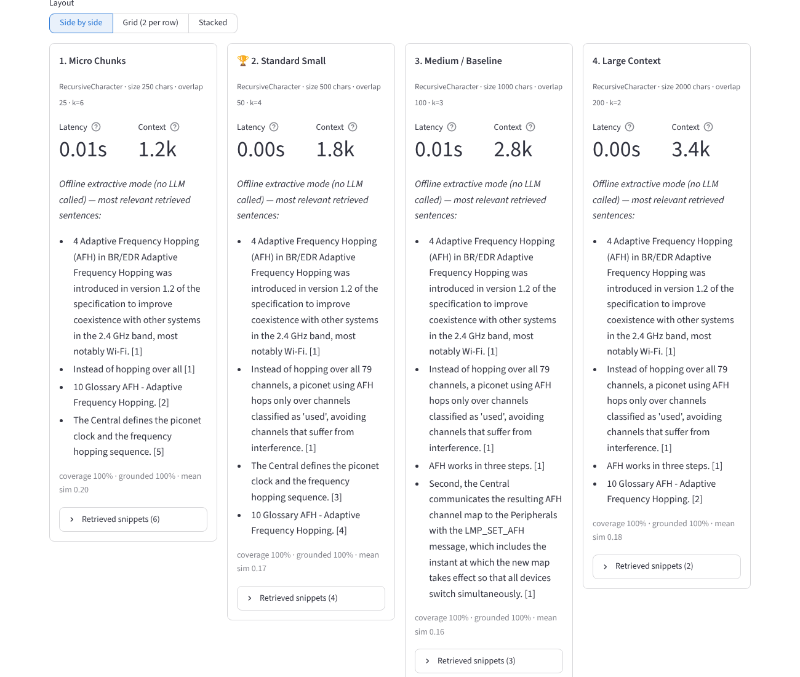

# 📡 RAG Lab: Bluetooth Specification

An interactive Streamlit app for **learning Retrieval-Augmented Generation (RAG)** using the Bluetooth
Core Specification PDF. Students change chunking strategy, chunk size, overlap, embedding model, vector
store, top-k and LLM settings, then see how each change affects the retrieved context, the answer, its
accuracy and its latency.

| Tab | What you can do |
|-----|-----------------|
| 🧪 **Single RAG Experimenter** | Build one pipeline, see its stats (pages, chunks, average size, indexing time) and the chunk-length histogram, browse sample chunks with their metadata, ask questions, and inspect the answer, the scored context snippets, the latency breakdown and the exact prompt sent to the LLM. |
| 📊 **Multi-RAG Benchmark** | Edit 5 preset configurations (micro → large chunks, plus a token-based one), build them in parallel with a progress bar per index, ask all of them the same question, compare answers side by side, and read the automatically generated insights (coverage, groundedness, consensus, optional reference-answer F1 and LLM-as-judge scores, charts and discussion prompts). |


*Five configurations answering the same AFH question. The micro-chunk answer stops at "Instead of hopping
over all [1]": the rest of that sentence was in the next chunk.*

The app also runs **fully offline**. If there is no API key and no model download, it falls back to a
bundled sample PDF, hashing embeddings and an extractive "no-LLM" answerer, so a classroom can always
start it.

---

## 🚀 Quick start

### 1. Get the code and create a virtual environment (Python 3.10–3.13)

```bash
git clone https://github.com/sweetdsp/RagSystemForBTSpec.git
cd RagSystemForBTSpec

python3 -m venv .venv
source .venv/bin/activate            # Windows: .venv\Scripts\activate
python -m pip install --upgrade pip
```

### 2. Install the dependencies

```bash
# Optional but recommended: CPU-only PyTorch (~200 MB instead of a multi-GB CUDA build)
pip install torch==2.14.1 --index-url https://download.pytorch.org/whl/cpu

pip install -r requirements.txt
```

### 3. Configure environment variables

```bash
cp .env.example .env                 # Windows: copy .env.example .env
```

Edit `.env` and set what you need:

| Variable | Needed for |
|----------|-----------|
| `OPENAI_API_KEY=sk-...` | OpenAI embeddings (`text-embedding-3-small/large`) and chat models (`gpt-4o-mini`, …) |
| `OLLAMA_BASE_URL` | Local Ollama models (default `http://localhost:11434`) |
| `DEFAULT_PDF_PATH` | The PDF used when nothing is uploaded (default `data/bluetooth_core_spec.pdf`) |

You can also export the variables directly in your shell, e.g. `export OPENAI_API_KEY=sk-...`
(PowerShell: `$env:OPENAI_API_KEY="sk-..."`). Real environment variables take precedence over `.env`.

**Optional: local models with Ollama.** No API key needed:

```bash
# install from https://ollama.com, then:
ollama pull llama3.2
ollama pull nomic-embed-text
ollama serve                         # if it is not already running
```

### 4. The Bluetooth specification

The repository includes the **Bluetooth Core Specification v5.4** at `data/bluetooth_core_spec.pdf` (3,141
pages); the app loads it by default. You can also upload any other PDF in the sidebar. If the spec file is
missing, the app falls back to the bundled 6-page primer `data/sample_bluetooth_primer.pdf`.

The first full parse of the spec takes about a minute. The page text is then cached in `.cache/`, so later
builds, even after restarting the app, take seconds. Use the sidebar's **Jump to section** list (built from
the PDF's bookmarks) to index a single Vol/Part. See [`data/README.md`](data/README.md) for where each example
question is answered.

### 5. Launch the app

```bash
streamlit run app.py
```

Open <http://localhost:8501>.

### 6. Run the tests (offline, about 2 seconds)

```bash
pytest -q
```

---

## 🧭 Suggested classroom workflow

1. **Tab 1**: build with the defaults (Recursive, 1000/100, k=4) and ask *"What are the power classes
   defined for Bluetooth LE?"*. Open the retrieved snippets: which pages did the answer come from?
2. Change **only** the chunk size to 200 and rebuild. Compare the chunk count, the histogram and the answer.
3. Switch the strategy to `CharacterTextSplitter` and look at the histogram's max chunk length. Why do some
   chunks exceed the target size?
4. Change **k** (no rebuild needed) and watch the context size, tokens and latency.
5. **Tab 2**: build the 5 presets and ask *"Explain the adaptive frequency hopping (AFH) mechanism in
   detail."* Read the insights. Did small chunks lose context? Did large chunks add noise?
6. Paste a reference answer from the spec, or enable the LLM judge, and see whether the "winner" changes.
7. Swap the embedding model (OpenAI vs MiniLM vs offline hashing) and rebuild. How much does retrieval
   quality depend on the embedding?

The whole spec (~5.4 M characters) is the realistic "needle in a haystack" setting. Use **Jump to section**
(e.g. *Vol 6 › Part A: Physical Layer Specification*) for fast, focused experiments. Rough figures for the whole
document: about 24k chunks at 250 chars and 6.6k at 1000 chars; about 1.4 M tokens to embed (a few US cents
with `text-embedding-3-small`; several minutes on CPU with MiniLM).

---

## 🏗️ Architecture

```
app.py                     Streamlit entry point (page setup, tabs)
ui/
  sidebar.py               document + model settings shared by both tabs
  single_tab.py            Tab 1: Single RAG Experimenter
  benchmark_tab.py         Tab 2: Multi-RAG Benchmark (editable presets, parallel build/query, cards, insights)
  components.py            metrics, chunk previews, snippet accordions, Altair charts
  state.py                 session-state caching (parsed PDF, indexes) and memory release
rag_lab/                   UI-agnostic RAG library (no Streamlit imports: reuse it from notebooks or FastAPI)
  settings.py              .env loading, model catalogs, safety limits
  errors.py                user-facing exception hierarchy (message + hint)
  pdf_loader.py            pypdf parsing, page ranges, bookmarks → sections, header/footer removal, corrupt/encrypted PDF handling
  disk_cache.py            on-disk cache of extracted pages and bookmarks (keyed by file hash)
  chunking.py              Recursive / Character / Token splitters; chunks mapped back to page numbers
  embeddings.py            OpenAI / HuggingFace / Ollama / offline hashing embeddings (cached per model)
  vector_store.py          in-memory FAISS or ChromaDB, both normalised to cosine similarity
  llm.py                   grounded prompt with [n] citations; OpenAI / Ollama / offline extractive answerer
  pipeline.py              build_index() and answer_question() with timings
  benchmark.py             5 presets + thread-pool build/query helpers with a thread-safe progress board
  insights.py              proxy metrics, LLM judge and plain-language observations
scripts/make_sample_pdf.py regenerates the bundled primer PDF
tests/                     offline pytest suite
```

```
PDF ─► pypdf ─► clean pages ─► splitter ─► chunks(+page metadata) ─► embeddings ─► FAISS / Chroma
                                                                                       │
question ─► embed ─► top-k search ─────────────────────────────────────────────────────┘
                         │
                         └─► numbered context + question ─► LLM ─► answer with [n] citations
```

### Design notes

- **Chunks can span pages.** Pages are joined before splitting, and each chunk's character offset is mapped
  back to `page_start`/`page_end`, so large chunks behave as they would in production and every snippet can
  still be cited by page.
- **Comparable scores.** FAISS stores L2-normalised vectors (cos = 1 − d²/2) and Chroma uses its cosine
  space (cos = 1 − d). The UI shows both the raw distance and the cosine similarity.
- **Controlled experiment.** In the benchmark, embedding model, vector store and LLM are shared (set in the
  sidebar). Only chunking and k vary between the 5 systems.
- **Running headers/footers** such as *"Bluetooth SIG Proprietary | Vol 6, Part B page 2860"* are
  detected and removed. Lines at the page edges are compared with digits ignored, both document-wide and
  within a ±5-page window (because the spec's headers change per Part). Otherwise they end up in nearly
  every chunk. Text from figures drawn in symbol fonts (which extracts as glyph garbage) is dropped too.
- **Sections from bookmarks.** The PDF outline drives the section picker and gives every chunk a
  `section` breadcrumb (*Vol 6: Low Energy Controller › Part A: …*) that is shown in the UI and the prompt.
- **Parse cache.** Extracted page text and bookmarks are cached per file hash in memory and in `.cache/`.
- **Per-config failure isolation.** If one configuration fails (for example the token splitter is offline),
  the error shows on its card and the others still run.

### Error handling and memory management

| Situation | Behaviour |
|-----------|-----------|
| Missing `OPENAI_API_KEY` | Sidebar shows ❌ and marks OpenAI options; selecting them gives a clear message with alternatives. |
| Corrupt or non-PDF file, password-protected PDF | `PDFLoadError` with a hint (re-download, `qpdf --decrypt`). Empty-password "copy-protected" PDFs are decrypted automatically. |
| Scanned (image-only) PDF | "No extractable text" plus an OCR hint (`ocrmypdf`). Single unreadable pages are skipped, not fatal. |
| Ollama not running, network or quota errors | Caught per request and shown with a troubleshooting hint. They never crash the app. |
| Very large documents | Page-range selection, `MAX_UPLOAD_MB`, `MAX_CHUNKS_PER_INDEX` safety cap, batched embedding with progress. Only one parsed PDF is kept, and old indexes are closed before new ones are built. |
| Freeing RAM | Sidebar **🧹 Free all indexes & caches** deletes every index (and Chroma collections), the parsed PDF and cached embedding models, then runs the garbage collector. |

> **Note:** the first use of `TokenTextSplitter` downloads tiktoken's `cl100k_base` file (~1 MB), and the
> first use of a HuggingFace model downloads it (~90 MB for MiniLM). On air-gapped machines, pre-populate
> `TIKTOKEN_CACHE_DIR` / `HF_HOME`, or use the character splitters and offline hashing embeddings.

---

## 📄 License

GPL-3.0, see [LICENSE](LICENSE). The Bluetooth Core Specification in `data/` is © Bluetooth SIG
and is subject to the Bluetooth SIG's own terms, not this repository's license.
